# Violet Reach — Stilhandbuch

## Zielbild

Eine helle, bewohnbar wirkende Wildnis, deren geologische und gebaute Größenordnung
erst beim Näherkommen verständlich wird. Mattes Elfenbein über olivgrünem Boden,
tiefe Schluchten, türkisgraues Wasser und wenige, klar violette Energiezentren.
Stilisiert-realistisch: glaubwürdige Oberflächen, lesbare große Formen, keine
fotorealistische Kleinteiligkeit auf Kosten der Silhouette. Keine Cartoon-Konturen,
kein flächendeckender Neonlook, keine glänzende Plastikarchitektur.

**Referenz, nicht Kopie.** Die Bilder liefern Licht, Rhythmus, Farbverhältnisse und
Größenkontrast. Wir übernehmen weder die gezeigten Karten, Landmarken, Fahrzeuge,
Symbole noch deren genaue Anordnung. Eigene Bauprofile und regionale Geschichten
entwickeln; auch die Referenznamen im Videobild sind keine Namen unserer Welt.

## Herkunft und Lesart

14 Standbilder aus den zwei bereitgestellten Telefonaufzeichnungen. Die Videos
werden nicht eingecheckt. `reference/frames.json` dokumentiert Aufnahmezeitpunkt
und exakten Ausschnitt in Originalpixeln: langes Video 1170 × 659, kurzes Video
1154 × 659 (seitliche Rundung entfernt), ohne Skalierung. Telefonoberfläche und
äußere schwarze Balken sind entfernt; **spielinterne Schrift/HUD bleibt** als
Bestandteil der Quelle sichtbar und ist keine Gestaltungsreferenz.

Reproduktion mit ffmpeg und Pillow:

```sh
~/art-env/bin/python tools/art/references.py <kurzes-video.mp4> <langes-video.mp4>
~/art-env/bin/python tools/art/palette.py
~/art-env/bin/python tools/art/palette.py --check
python3 tools/vr.py swatches
```

Das kurze Video ist `ScreenRecording_11-21-2026_15-30-40_1.mp4` (17,59 s),
das lange `ScreenRecording_11-21-2026_15-29-47_1.mp4` (37,99 s); die Dateinamen
sind maßgeblich, nicht die anfängliche Schätzung ihrer Länge.

## Licht und Atmosphäre

- Weiches Tageslicht mit gerichteter Sonne. Cremefarbene Lichtseiten, neutral bis
  blaugraue Schatten; Weiß bleibt strukturiert, nie ausgebrannt.
- Nahbereich mit satten dunklen Laubschatten. Mit Entfernung sinkt der Kontrast,
  die Farben nähern sich `haze`; Berge dürfen in Wolkenschichten verschwinden.
- Breite Wolkenbänder statt gleichmäßigem Nebel. Sichtachsen über mehrere Kilometer
  offen halten; Bodendunst in Schluchten, nicht als grauer Filter über allem.
- Kleine Emissionsflächen an Kristalladern, helle Kerne an Energieobjekten. Leuchten
  ersetzt weder Form noch Lichtsetzung. Bloom ist ein späterer Laufzeiteffekt und
  darf nicht in die Grundfarbe gemalt werden.
- Materialmuster nutzen für alle Oberflächen dieselbe neutrale Studioumgebung,
  zwei Flächenlichter und eine Sonne, AgX und Cycles/CPU. Sie sind kein fertiges
  Landschaftslicht und keine Farbmessung des Videos.

## Palette und Farbregeln

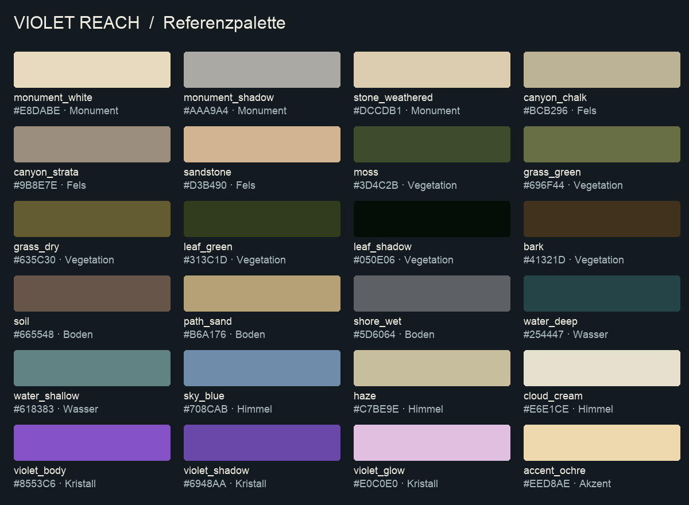

[`palette.json`](palette.json) ist die einzige Farbquelle der Bibliothek. Jede
Farbe besitzt Rolle, sRGB-Hexwert, lineares RGB, Bild und Messrechteck. Das Skript
misst den Kanalmedian kuratierter Regionen (keine willkürlichen Hexwerte).
Linearisierung nach IEC 61966-2-1; nicht einfach sRGB durch 255 teilen.
Die komprimierten Aufnahmen enthalten bereits Beleuchtung und Tonemapping:
Die Werte sind **Stilanker, keine physikalisch gemessenen Albedos**.

| Familie | Verbindliche Farbnamen | Regel |
|---|---|---|
| Monumente | `monument_white`, `monument_shadow`, `stone_weathered` | Helle Hauptmasse; Schatten nicht schwarz einfärben. Schmutz lokal, nicht als Vollflächenmarmor. |
| Felsen | `canyon_chalk`, `canyon_strata`, `sandstone` | Vorwiegend heller geschichteter Stein; warmer Sandstein als regionaler Kontrast. |
| Vegetation | `grass_green`, `grass_dry`, `leaf_green`, `leaf_shadow`, `moss`, `bark` | Oliv statt Giftgrün; größere trockene und schattige Inseln statt Pixelrauschen. |
| Boden | `soil`, `path_sand`, `shore_wet` | Erde verbindet Vegetationspolster; nasse Ufer dunkler und glatter. |
| Wasser | `water_deep`, `water_shallow` | Tiefe entsättigt blaugrün; flacher Rand heller, keine karibische Neonfläche. |
| Himmel | `sky_blue`, `cloud_cream`, `haze` | Zur Ferne wärmer und heller; keine zweite dominante Akzentfarbe. |
| Energie | `violet_body`, `violet_shadow`, `violet_glow` | Violett gezielt an Landmarken und Kristallen, nicht an jedem Stein. |
| Akzente | `accent_ochre` | Warme Stein-/Keramikfassungen sparsam. Metall/Gold ist in den Bildern nicht eindeutig belegt und wird nicht vorausgesetzt. |

Als Kompositionshilfe: Natur dominiert, helle Bauten bilden große ruhige Flächen,
Violett bleibt eine kleine Minderheit. Keine starre Prozentquote pro Einzelobjekt.

## Formensprache und Maßstab

Blender-Einheit = **1 m**, Z nach oben. Objektursprung mittig auf Standfläche,
angewandte Skalierung vor Materialzuweisung. Eine 1,8-m-Maßfigur gehört zum
Prüfblatt. Die folgenden Größen sind **Bau-Zielkorridore**, aus Baum-/Figuren-
Verhältnissen der Bilder geschätzt, keine Vermessung der Originalwelt. Perspektive,
Überfluggeschwindigkeit und Videotexte machen absolute Maße unsicher.

### Monumente

Große glatte Kalksteinmassen, verjüngte Pfeiler, offene Durchbrüche und lange,
gebogene Rippen mit unterschiedlichen Höhen. Radien wechseln weich; Brüche bleiben
scharf genug, um Stein zu lesen. Neben der heroischen Kontur brauchen Nahansichten
Fugen, abgeplatzte Kanten und Poren. Keine kopierten Kronen- oder Torgrundrisse.

Rippen 30–100 m hoch, 2–8 m stark; große Tore 25–80 m Durchlasshöhe,
Ruinenmodule 3–12 m, Treppenstufen 0,15–0,20 m. Kleine begehbare Öffnungen
mindestens 2,2 m hoch. Große Formen als Geometrie, nicht als Bump simulieren.

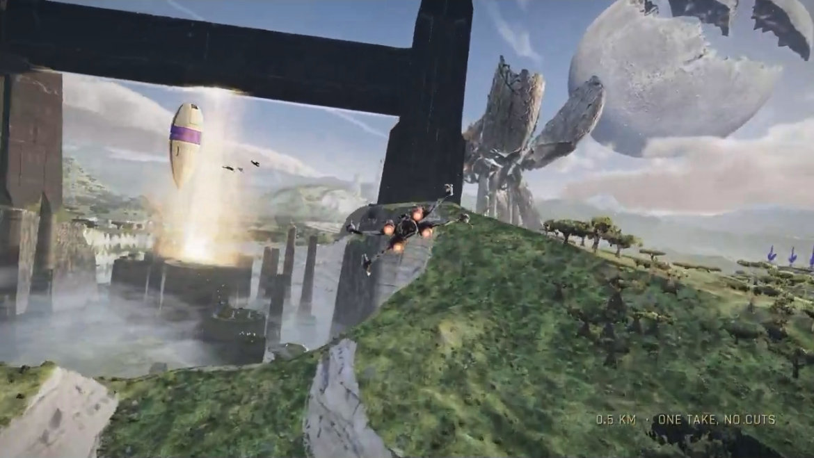
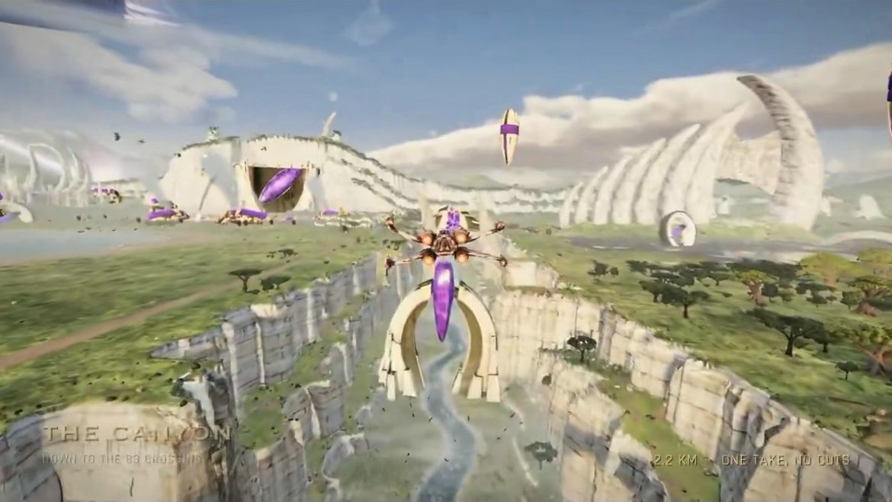
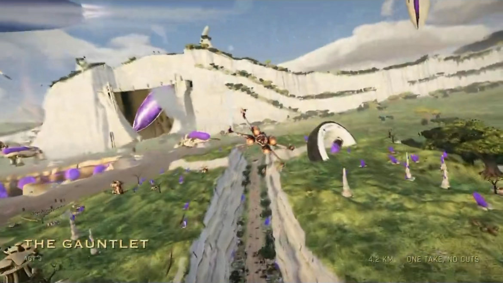
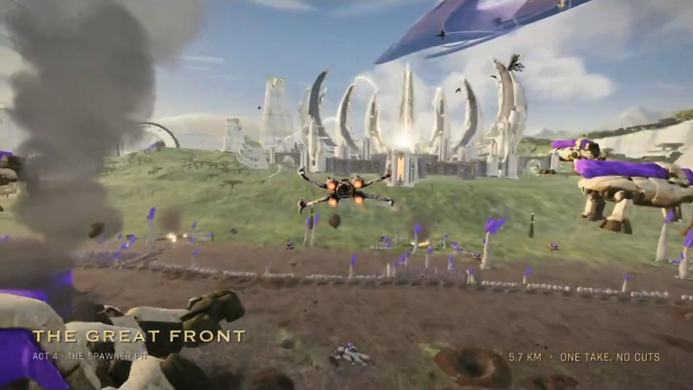

### Felsen und Canyon

Horizontale Schichtbänder werden von langen senkrechten Brüchen durchtrennt.
Große helle Bruchflächen, dazwischen dunklere Fugen; grasbewachsene Terrassen
statt rundgeschliffener Lärmwände. Silhouette stufig und kantig, kein gleichmäßiges
Noise auf einer Kugel. Lokale warme Naturbögen dürfen gebaute weiße Bögen kontrastieren.

Canyonwände 40–150 m, Schichtpakete 1–6 m; Geröll 0,1–2 m, Einzelfelsen 2–12 m.
Materialschichtung ist nur Feindetail: die großen Bänke werden modelliert.

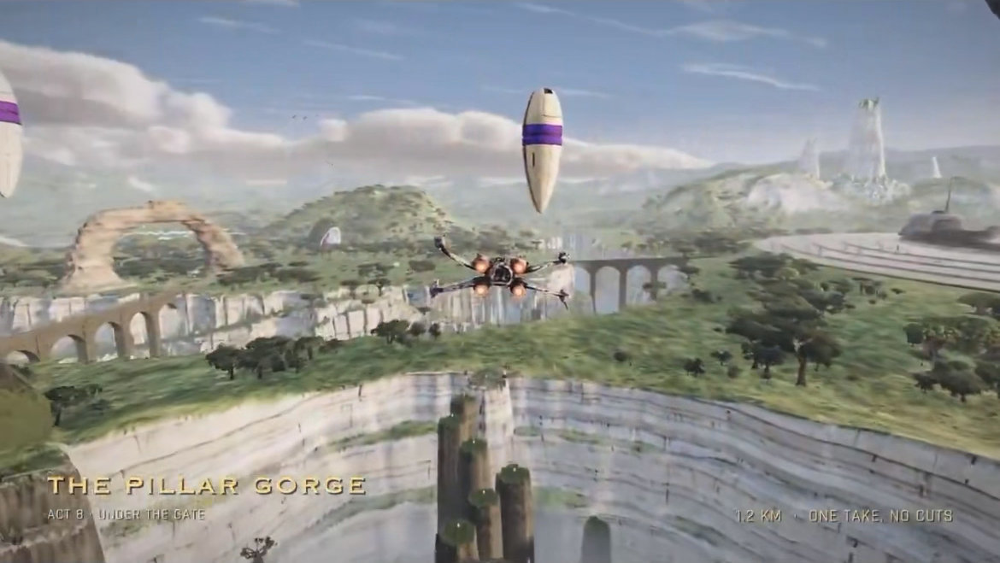
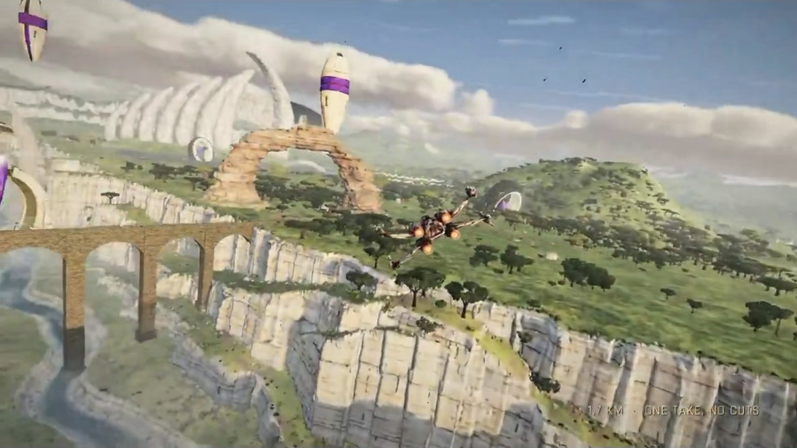

### Vegetation und Boden

Breite, unregelmäßige Baumkronen mit Luft zwischen den Gruppen. Dunkle Unterseiten,
hellere olivfarbene Oberseiten; Stammgabeln und Wurzelansätze sichtbar. Bodennah
wechseln Farne, breite Blätter, Halme und offene Erde. Keine gleichmäßige grüne
Teppichfläche, kein zufälliges Streuen ohne Gruppenrhythmus.

Bäume 6–18 m, Kronen 5–14 m breit, Stamm Ø 0,3–1,2 m; Gras 0,15–0,7 m,
Farne 0,3–1 m, Sträucher 0,5–2,5 m. Wege 2–5 m breit. Details unter 2 cm eher
backen; Halme und Blattsilhouetten auch mit eigener Geometrie bauen.

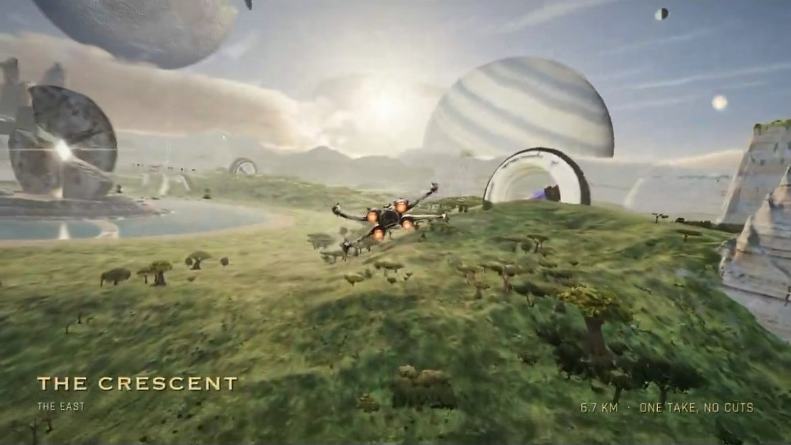
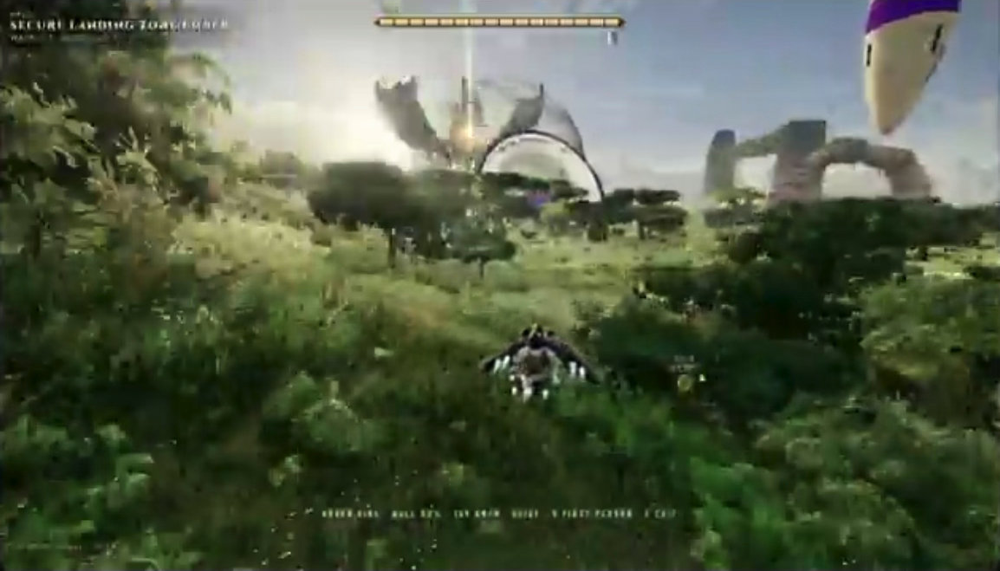
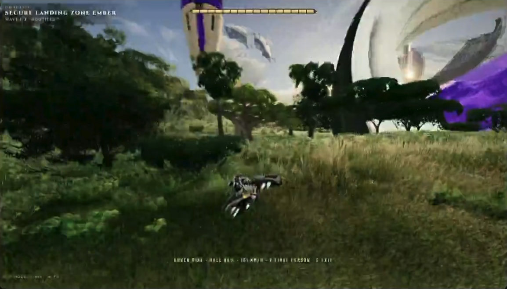
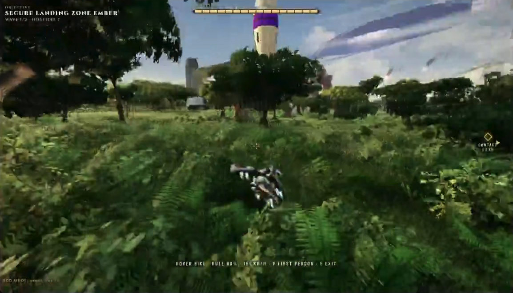

### Kristalle und Energie

Gerichtete Facetten und Wachstumslinien; Gruppen mit einem Hauptkörper und kleineren
Gegengewichten. Dunkle Körperfarbe muss neben hellen Adern sichtbar bleiben.
Keine Glaskugeln, keine Transmission, kein gleichmäßig weißes Emissionsmaterial.
Energieobjekte dürfen glatter und heller sein, behalten aber ein violettes Volumen.
`violet_crystal` nutzt dunkle Kerne, innere Bänder und gerichtete Facettenlichter;
Risse leuchten nur schwach. `violet_energy` zeigt dagegen überwiegend emissive,
gesättigte fließende Filamente mit schmalen hellen Kernen auf dunklem violettem
Grund. Kein gleichmäßiges weißes Zellliniengitter und keine blassen Marmorwolken.

Kristallgruppen 0,5–5 m; regionale Energiekerne 10–35 m als seltene Landmarken.
Das genehmigte Phase-0-Beweisobjekt behält seine eigenen Materialien und Freigabe.

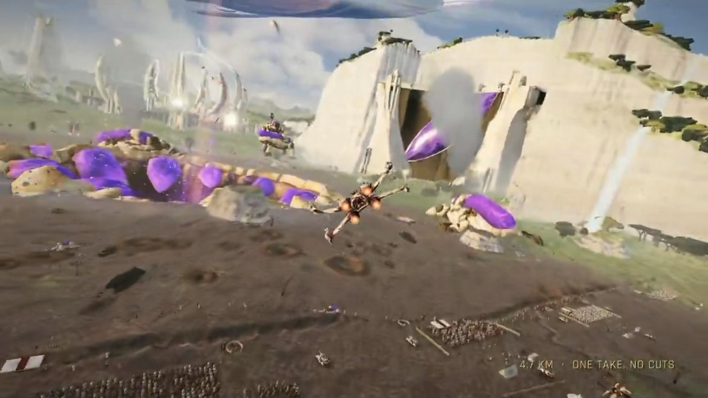

### Wasser

Breite, ruhige Flächen mit feinen Wellen und klaren, sanft geschwungenen Ufern;
Flüsse folgen der Schlucht, nicht einem mechanischen Kanalprofil. Nasse Ufersteine
glatter und dunkler als trockene Klippen. Flüsse 8–30 m breit, Seen 250–900 m,
Uferübergang 2–12 m. Wasserstand und Fließrichtung geometrisch konsistent halten.

`water_opaque` ist ein opaker backbarer Grundlook. Echte Spiegelungen, animierte
Wellen, Schaum und Tiefeneffekte sind Laufzeitaufgaben späterer Phasen; die Bibliothek
behauptet nicht, sie in eine statische Textur backen zu können.

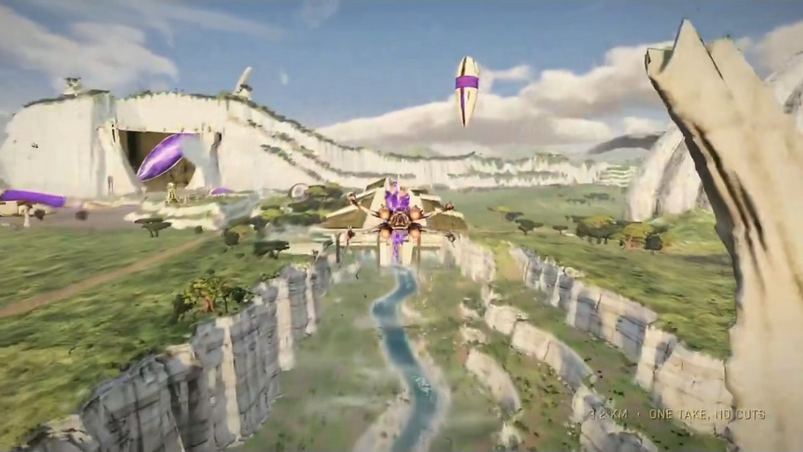
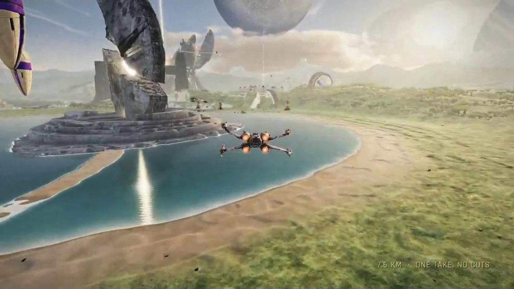

### Himmel und schwebende Körper

Große fragmentierte oder geschichtete Volumen, keine überall verteilten identischen
Kugeln. Ein bis zwei dominante Fernkörper pro Sichtachse. Ruhige breite Wolken
mit hellen Oberseiten und grauen Unterseiten, lange dünne Schleier darüber.
Fernkörper etwa 300–1000 m als gestalterischer Korridor; Wolkenunterkante grob
0,8–2 km. Diese Größen sind besonders unsicher. Kein Wolkenvolumen in Objekt-
Materialien backen; Himmel und Dunst werden im Laufzeit-/Atmosphäre-Teil umgesetzt.

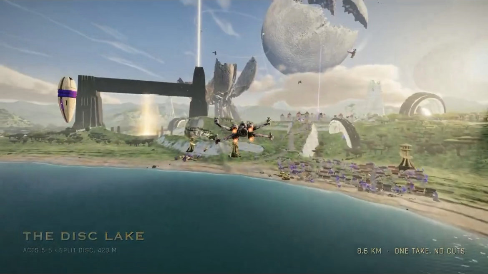

## Materialregeln

1. Neue `build.py` importieren `vrmat` und verwenden `vrmat.get("…")` aus der
   [Bibliothek](materials/README.md). Keine private Kopie der Palette.
2. Prozedurale Principled-BSDF-Oberflächen, Alpha = 1, Transmission = 0.
   Objektkoordinaten in Metern; Skalierung anwenden. Keine Kamera-, Fresnel- oder
   Transparenztricks als Grundfarbe. Kein ungeprüftes Zufallsrauschen.
3. Makroformen, Fugen und gebrochene Kanten modellieren. Die Bibliothek liefert
   mehrstufige Noise-/Voronoi-Struktur, Poren, Rauheitsvariation und Normalendetail.
   Pointiness bei verwittertem Stein ist geometrieabhängig: am finalen Mesh prüfen.
4. Farbe, Normalen, Rauheit, Emission und AO über die bestehende Pipeline backen.
   Objektskalierung/Koordinaten während des Backens nicht ändern. Shader-Details
   unterhalb eines Zieltexels nicht als Silhouettendetail versprechen.
5. `get` ist gecacht. Nie das zurückgegebene Material für ein einzelnes Objekt
   verändern; gegebenenfalls `.copy()` verwenden und Abweichung dokumentieren.
6. Änderungen an Bibliothek **oder Palette** ändern den Quellhash nur der Assets,
   die `vrmat` importieren; diese brauchen neue Prüfblätter und Freigaben. Statische
   Python-Imports verwenden, keine dynamischen Imports an der Hash-Erkennung vorbei.

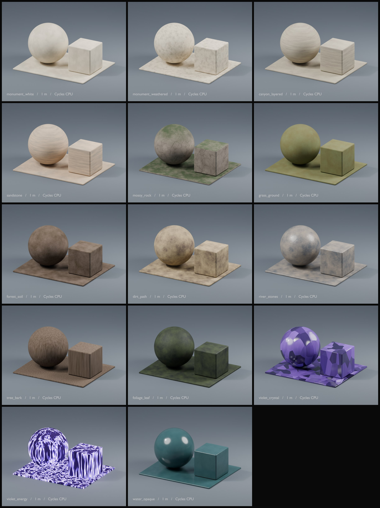

## Prüfmaßstab

Vor Freigabe Prüfblatt in voller Auflösung ansehen, nicht nur Kontaktblatt.
Jeweils **Silhouette zuerst**, dann Maßfigur, Farbmassen, Nahoberfläche und Bake.

| Familie | Referenzbilder | Ablehnen, wenn … |
|---|---|---|
| Monumente | 01, 04, 06, 08 | weißer Kunststoff, gleich breite Rippen, fehlende Fugen/Brüche, maßstabslose Öffnungen |
| Fels/Canyon | 02, 03, 05 | kugeliges Noise, senkrecht gestreckte Textur, keine Schicht-/Bruchhierarchie |
| Vegetation/Boden | 09, 12–14 | Giftgrün, gleichmäßige Verteilung, keine dunklen Kronenunterseiten, Boden nur flach grün |
| Kristall/Energie | 04, 07 | rund/plastisch, fast weiß durch Emission, keine lesbaren Facetten, Violett dominiert jede Fläche |
| Wasser/Ufer | 05, 10, 11 | Neonblau, harter unplausibler Rand, Wasser bergauf, trockene und nasse Steine identisch |
| Himmel/Fernkörper | 01, 09, 11 | fehlende Tiefenstaffelung, gleichförmige Kugelwolken, Fernkörper erschlagen alle Sichtachsen |

Die Swatches prüfen die Materialantwort, nicht den fertigen Objektbau. Sichtbare
Wiederholung, Bump-Flimmern, Nahtstellen, gestreckte Texturen oder verlorene
Details nach dem Bake sind Mängel, selbst wenn der Shadergraph aufwendig aussieht.
Die sechs Tor-Kriterien und die unabhängige Prüfung aus `docs/SESSIONS.md` bleiben
verbindlich; dieses Dokument ersetzt keine Objektfreigabe.
