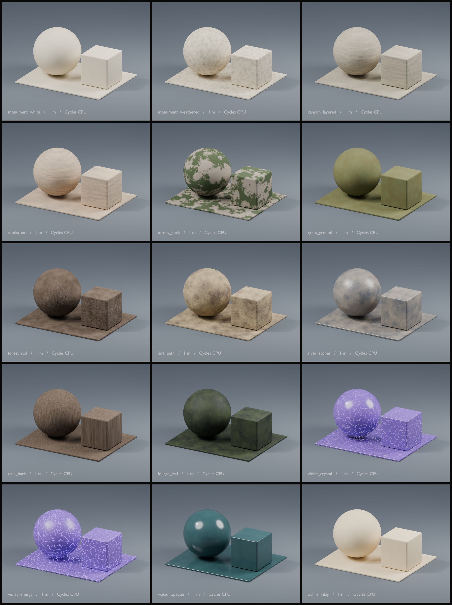

# Materialbibliothek

Quelle: [`tools/blender/vrmat.py`](../../tools/blender/vrmat.py), Farben direkt aus
[`palette.json`](../palette.json), Stilregeln in [`STYLE.md`](../STYLE.md).

```python
import vrmat

obj.data.materials.append(vrmat.get("monument_white"))
```

`get(name)` ist deterministisch und nach Namen in `bpy.data.materials` gecacht.
Unbekannte Namen werden mit `KeyError` abgelehnt. Keine Zufallswerte, keine geladenen
Texturen, nur opake Principled-BSDF-Netze. Einheit 1 m; Objektskalierung vor der
Zuweisung anwenden. Objektkoordinaten bleiben beim Source-Bake erhalten. Alle
Oberflächen haben Alpha 1, Metallanteil 0 und Transmission 0.

## Materialien

Parameter in `SPECS`: zwei Palettennamen, mittlere Rauheit, Bump-Distanz in Metern,
Strukturfamilie. Rauheit variiert zusätzlich um −0,13/+0,08. Die Tabellenwerte sind
Ausgangswerte, keine individuellen `get`-Argumente; lokale Varianten über `.copy()`
und dokumentierte Node-Änderungen, nie den gemeinsamen Cache still verändern.

| Name | Aussehen und Einsatz | Rauheit / Bump-Distanz | Struktur |
|---|---|---|---|
| `monument_white` | Sauberer warmer Kalkstein; große neue Rippen und Verkleidung | 0,76 / 0,002 m | Feine Poren, leichte Mineralwolken, matte Flächen |
| `monument_weathered` | Fleckiger, rauerer Altstein; Ruinen und exponierte Sockel | 0,88 / 0,012 m | Poren, Patina, mehrstufiges Noise und dezente Pointiness-Abnutzung |
| `canyon_layered` | Heller, horizontal geschichteter Kalkfels | 0,88 / 0,014 m | Gestrecktes 3D-Noise, Poren; große Schichtbänke zusätzlich modellieren |
| `sandstone` | Warmer Naturstein für Bögen und trockene Ausläufer | 0,87 / 0,008 m | Geschichtetes Korn, ohne Metallglanz |
| `mossy_rock` | Dunkler Stein mit unregelmäßigen oliven Moosinseln | 0,92 / 0,009 m | Grobmaske, feines polstriges Noise und Steinporen |
| `grass_ground` | Matte olivgrüne Grasnarbe; Untergrund unter Halmen | 0,94 / 0,006 m | Breite Farbflecken und gerichtetes Feinkorn; keine Halmsilhouetten |
| `forest_soil` | Dunkle Erde unter Baumgruppen | 0,95 / 0,008 m | Voronoi-Körnchen, feine Rauheit, größere Tonwertwolken |
| `dirt_path` | Hellerer trockener Erdweg | 0,90 / 0,004 m | Kleinteiliges mineralisches Korn; Fahrspuren als Geometrie/Decal später |
| `river_stones` | Graue, feuchte Ufersteine | 0,34 / 0,003 m | Gerundetes Voronoi-Relief, niedrigerer Glanz als Wasser |
| `tree_bark` | Braune Längsfurchen | 0,92 / 0,012 m | In Z gestrecktes Noise; Stammachse vor dem Backen beachten |
| `foliage_leaf` | Dunkles olivgrünes Blatt | 0,76 / 0,0005 m | Feine gerichtete Maserung; opakes Blattmesh statt Alpha-Karte |
| `violet_crystal` | Violetter opaker Körper, feine Wachstumsstreifen | 0,23 / 0,0004 m | Voronoi-Bruchadern mit Emission bis 0,55; Facetten durch Geometrie |
| `violet_energy` | Helleres violettes Energievolumen | 0,38 / 0,0002 m | Violette Bruchadern, Emission bis 3; kein transparentes Portal |
| `water_opaque` | Ruhiges tiefes Blaugrün | 0,19 / 0,0007 m | Gerichtete Mikrowellen; statischer Grundlook ohne Transparenz oder Animation |
| `ochre_inlay` | Warme helle Steinfassung, sparsam verwenden | 0,69 / 0,001 m | Feine Poren; ausdrücklich kein Gold/Metall |

`vrmat.load_palette()` prüft sRGB/Linear-Konsistenz und alle Materialfarbreferenzen.
Es gibt keine zweite Python-Farbkopie, die vom JSON abweichen könnte.
`python3 tools/test_gate.py` prüft gültige, leere und inkonsistente Paletten sowie
den bedingten Bibliotheks-/Palettenhash. Die Bildmessung selbst prüft
`~/art-env/bin/python tools/art/palette.py --check` (Pillow erforderlich).

## Muster rendern und beurteilen

```sh
python3 tools/vr.py swatches
```

Blender 5.3, Cycles **CPU**, 48 Samples, fester Seed 1701, AgX, identisches neutrales
Studio mit zwei Flächenlichtern und Sonne. Jede 800 × 640-Probe zeigt Kugel Ø 1,5 m,
bevelten Block und eine Bodenplatte; Beschriftung nennt den Materialschlüssel.
Ausgabe: `swatches/<name>.png` und das beschriftete Kontaktblatt
[`swatches.jpg`](swatches.jpg). Kein `.blend` nötig, kein Pillow im Renderprozess.



Jedes PNG in voller Größe prüfen: Poren dürfen nicht wie Löcher, Schichten nicht
wie Holz und Blattflächen nicht wie Lack aussehen. Danach auf realer Geometrie
gegen die zugehörigen Bilder aus `art/reference` prüfen. Die Kugel ist keine
Kristall- oder Baumform; die Fläche entlarvt Wiederholungen und Streckung.
Pointiness hängt von der Topologie ab und ist auf flachen Flächen schwach.
Diese Bibliothek ist kein Ersatz für modellierte Kanten, Geröll oder Grasbüschel.

## Backen und Grenzen

Die vorhandene Export-Pipeline backt Base Color, Normalen, Rauheit, Emission und AO.
Licht-/Kameraeffekte gehören nicht in den Shader. Nach dem Bake immer die Texturen
am LOD0 und die unteren Detailstufen überprüfen. Emission ist backbar, ein
Lichthof oder dynamische Beleuchtung der Umgebung nicht. Wasser und Blätter
bleiben hier opak; spätere Laufzeitmaterialien brauchen eigene technische Prüfung.

Ändert sich `vrmat.py` oder `palette.json`, benötigen nur Assets mit statischem
`vrmat`-Import neue Render und Reviews. Bestehende Phase-0-Assets ohne diesen
Import behalten ihre Quellhashes und Freigaben.
